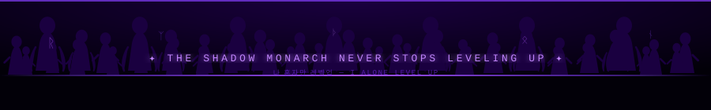

<!--
  ╔══════════════════════════════════════════════════════════════════════════════╗
  ║         ⚔️  SHADOW MONARCH — poreddysaikiran6  ⚔️                           ║
  ║           나 혼자만 레벨업 — I ALONE LEVEL UP                                  ║
  ╚══════════════════════════════════════════════════════════════════════════════╝
-->

<!-- ══════ CINEMATIC HEADER — SHADOW ARMY + DUNGEON GATE ══════ -->
<p align="center">
  
</p>

<!-- ══════ TYPING ANIMATION ══════ -->
<p align="center">
  
</p>

<!-- ══════ BADGES ══════ -->
<p align="center">
  
  &nbsp;
  
  &nbsp;
  
</p>

<br/>

<!-- ══════ SYSTEM STATUS WINDOW ══════ -->
<p align="center">
  
</p>

<br/>

---

<!-- ══════ SUNG JIN-WOO + ABOUT ME ══════ -->
## 🌑 &nbsp;`[ SHADOW MONARCH'S CHRONICLE ]`


```python
class ShadowMonarch:

    name     = "Porreddy Sai Kiran"
    alias    = "poreddysaikiran6"
    rank     = "S-Class  ⚔️"
    title    = "The Shadow Monarch Developer"
    origin   = "India  🇮🇳"

    awakened_skills = [
        "Full Stack Development  🖥️",
        "Machine Learning & AI  🤖",
        "React / Next.js  ⚛️",
        "Python & Java Engineering  🐍",
        "SQL & MongoDB  🗄️",
    ]

    shadow_army  = ["Django", "Node.js", "TensorFlow",
                    "PyTorch", "Docker", "Git"]

    current_quest = "Building from the shadows... 🌑"
    power_level   = "∞ (Always growing)"

    def arise(self):
        print("The Shadow Monarch awakens...")
        return "나 혼자만 레벨업"
```

<br clear="right"/>

---

<!-- ══════ SUNG JIN-WOO GIF SHOWCASE ══════ -->
## ⚔️ &nbsp;`[ THE SHADOW MONARCH AWAKENS ]`

<p align="center">
  
  &nbsp;&nbsp;
  
  &nbsp;&nbsp;
  
</p>

<p align="center">
  
</p>

---

<!-- ══════ TECH STACK — STYLED AS SHADOW SKILLS ══════ -->
## 🔮 &nbsp;`[ SHADOW SKILLS ARSENAL ]`

<p align="center"><i>⚔️ Every skill is a shadow soldier summoned from mastery ⚔️</i></p>

### 💀 &nbsp;Shadow Language Skills
<p align="center">
  
</p>

### 🌐 &nbsp;Frontend — The Hunter's Interface
<p align="center">
  
</p>

### ⚙️ &nbsp;Backend — The Shadow Domain
<p align="center">
  
</p>

### 🤖 &nbsp;AI / ML — The Monarch's True Power
<p align="center">
  
  &nbsp;
  
  
  
</p>

### 🛡️ &nbsp;DevOps — The Shadow Army Support
<p align="center">
  
</p>

---

<!-- ══════ GITHUB STATS — "MONARCH POWER LEVELS" ══════ -->
## 📊 &nbsp;`[ MONARCH POWER LEVEL STATS ]`

<p align="center">
  
  &nbsp;
  
</p>

<!-- Streak — "Shadow Energy" -->
<p align="center">
  
</p>

<!-- Activity Graph -->
<p align="center">
  
</p>

---

<!-- ══════ SHADOW SNAKE ══════ -->
## 🐍 &nbsp;`[ SHADOW SERPENT DEVOURING COMMITS ]`

<p align="center">
  <picture>
    <source media="(prefers-color-scheme: dark)"
      srcset="https://raw.githubusercontent.com/poreddysaikiran6/poreddysaikiran6/output/github-snake-dark.svg"/>
    <source media="(prefers-color-scheme: light)"
      srcset="https://raw.githubusercontent.com/poreddysaikiran6/poreddysaikiran6/output/github-snake.svg"/>
    
  </picture>
</p>

---

<!-- ══════ TROPHIES ══════ -->
## 🏆 &nbsp;`[ DUNGEON CLEAR REWARDS ]`

<p align="center">
  
</p>

---

<!-- ══════ ACTIVE QUESTS ══════ -->
## 🗡️ &nbsp;`[ ACTIVE DUNGEON QUESTS ]`

<div align="center">

| &nbsp; | Quest Name | Type | Status | EXP |
|:------:|:----------|:----:|:------:|----:|
| ⚔️ | Building Full Stack Web Applications | `A-Rank Dungeon` | `IN PROGRESS` | `+800 XP` |
| 🤖 | Mastering Machine Learning & Deep Learning | `S-Rank Dungeon` | `IN PROGRESS` | `+1200 XP` |
| ☁️ | Cloud & DevOps Mastery | `B-Rank Dungeon` | `SCOUTING` | `+500 XP` |
| 📱 | Mobile App Development | `B-Rank Dungeon` | `SCOUTING` | `+400 XP` |
| 🎓 | Computer Science Degree | `S-Rank Main Quest` | `IN PROGRESS` | `+5000 XP` |
| 🌍 | Open Source Contributions | `Daily Quest` | `ONGOING` | `+∞ XP` |

</div>

---

<!-- ══════ SOLO LEVELING QUOTE CARD ══════ -->
<p align="center">
  
</p>

---

<!-- ══════ CONNECT — "OPEN A GATE" ══════ -->
## 🌐 &nbsp;`[ OPEN A GATE — SUMMON ME ]`

<p align="center">
  <a href="https://www.linkedin.com/in/poreddysaikiran6" target="_blank">
    
  </a>
  &nbsp;
  <a href="https://www.instagram.com/poreddysaikiran6" target="_blank">
    
  </a>
  &nbsp;
  <a href="mailto:poreddysaikiran6@gmail.com">
    
  </a>
  &nbsp;
  <a href="https://github.com/poreddysaikiran6" target="_blank">
    
  </a>
</p>

<br/>

<!-- ══════ FOOTER — MARCHING SHADOW ARMY ══════ -->
<p align="center">
  
</p>

<p align="center">
  
</p>
