<!--
  ╔══════════════════════════════════════════════════════════════════════════════╗
  ║         ⚔️  SHADOW MONARCH — poreddysaikiran6  ⚔️                           ║
  ║           나 혼자만 레벨업 — I ALONE LEVEL UP                                  ║
  ╚══════════════════════════════════════════════════════════════════════════════╝
-->

<!-- ══════ TOP STATUS BAR ══════ -->
<p align="center">
  
  &nbsp;
  
  &nbsp;
  
  &nbsp;
  
  &nbsp;
  
</p>

<!-- ══════ CINEMATIC HEADER BANNER (Animated SVG with Moon & Dungeon Gate) ══════ -->
<p align="center">
  
</p>

<!-- ══════ TYPING ANIMATION (Epic Solo Leveling & Guardian Quotes) ══════ -->
<p align="center">
  
</p>

<br/>

<!-- ══════ THE AWAKENING: SUNG JIN-WOO HERO SHOWCASE ══════ -->
## ⚔️ `[ THE SHADOW MONARCH'S AWAKENING ]`

<table>
  <tr>
    <td width="42%" align="center" valign="middle">
      
      <br/>
      <sub><b>Sung Jin-Woo (성진우) — The Shadow Monarch</b></sub>
    </td>
    <td width="58%" valign="top">
      <div align="center">
        
      </div>
      <br/>

```python
class ShadowMonarch:
    """The Developer Who Conquered the System."""
    hunter_name = "Porreddy Sai Kiran"
    alias       = "poreddysaikiran6"
    rank        = "S-Class Hunter"
    class_type  = "Full Stack & Machine Learning Engineer"
    mana_pool   = "Unlimited (Built on Caffeine & Clean Code)"
    
    awakened_runes = [
        "Full Stack Web Systems", "AI & Deep Learning",
        "React / Next.js", "Python & Java Engines",
        "Scalable Database Architecture"
    ]
    
    shadow_army = ["Node.js", "Django", "TensorFlow", "Docker", "Git"]
    
    def command(self):
        return "ARISE. (일어나라)"
```

    </td>
  </tr>
</table>

<br/>

---

<!-- ══════ CINEMATIC GALLERY: SUNG JIN-WOO IN ACTION ══════ -->
## 🔮 `[ THE SHADOW DOMAIN — VISUAL ARCHIVES ]`

<p align="center"><i>"Even death bows before the Monarch of Shadows."</i></p>

<table align="center" width="100%">
  <tr>
    <td width="33%" align="center" valign="top">
      <h4>⚡ Perception (감각)</h4>
      
      <br/><br/>
      <sub><b>Monarch's Vision:</b> Detecting system bottlenecks & code patterns with pinpoint accuracy.</sub>
    </td>
    <td width="34%" align="center" valign="top">
      <h4>👑 Shadow Extraction (그림자 추출)</h4>
      
      <br/><br/>
      <sub><b>The Arise Command:</b> Summoning shadows into production-grade deployments.</sub>
    </td>
    <td width="33%" align="center" valign="top">
      <h4>🗡️ Shadow Strike (단검 술)</h4>
      
      <br/><br/>
      <sub><b>Lethal Execution:</b> Rapid refactoring, clean architecture, and high-performance algorithms.</sub>
    </td>
  </tr>
</table>

<br/>

---

<!-- ══════ THE MONARCH'S CORE SOUL WEAPON: PYTHON & GUARDIAN MATRIX ══════ -->
## 🐍 `[ PRIMARY SOUL WEAPON — PYTHON 3 & GUARDIAN MATRIX ]`

<p align="center">
  <i>"In a world where algorithms rule the dungeons, Python is my absolute authority."</i>
</p>

<!-- Custom Animated Python Guardian Sci-Fi HUD -->
<p align="center">
  <a href="https://leetcode.com/u/sai_kiran_0609/" target="_blank">
    
  </a>
</p>

<div align="center">

| Metric | Rating / Value | Worldwide Standing | Hunter Badge |
|:-------|:--------------:|:------------------:|:------------:|
| **Contest Rating** | `2,173` | **Top 1.07%** of all global competitors | 🏆 **GUARDIAN** |
| **Global Ranking** | `#9,137` | Out of **890,724+** active hunters worldwide | 👑 **ELITE S-RANK** |
| **Dungeons Conquered** | `600 Problems` | **116 Hard (S-Rank)** • **318 Medium** • **166 Easy** | ⚔️ **DUNGEON CLEAR** |
| **Max Coding Streak** | `343 Days` | 364 Active Days in the past year | 🔥 **UNBROKEN WILL** |
| **Primary Combat Core** | `Python 3` | 509+ Submissions executed with Pythonic elegance | 🐍 **PYTHONIC MONARCH** |

</div>

<br/>

<!-- LeetCode Interactive Card & Profile Badge -->
<p align="center">
  <a href="https://leetcode.com/u/sai_kiran_0609/" target="_blank">
    
  </a>
</p>

<p align="center">
  <sub>⚡ <i>Click the matrix card above to inspect my live <a href="https://leetcode.com/u/sai_kiran_0609/">LeetCode Profile (sai_kiran_0609)</a></i></sub>
</p>

<br/>

---

<!-- ══════ RPG SYSTEM STATS WINDOW (UPDATED WITH GUARDIAN LORE) ══════ -->
## 📜 `[ HUNTER ATTRIBUTE MATRIX — S-RANK GUARDIAN ]`

<div align="center">

| Attribute | Level / Value | Assigned Domain & Capability | Combat Rating |
|:----------|:-------------:|:-----------------------------|:-------------:|
| **STR (Algorithmic Strength)** | `99 / 100` | 600 Dungeons Cleared (116 S-Rank Hard Raids conquered in Python) | `S-TIER MAX` |
| **AGI (Execution Speed)** | `98 / 100` | $O(1)$ and $O(\log N)$ optimization, lightning-fast API responses | `S-TIER` |
| **INT (Architectural Intellect)** | `99 / 100` | Deep Learning, Neural Network architectures, scalable system designs | `S-TIER MAX` |
| **VIT (Vitality / Resilience)** | `100 / 100` | 343 Consecutive Days Coding Streak — Unyielding endurance under pressure | `UNLIMITED ∞` |
| **SEN (Perception / Code Sense)** | `96 / 100` | Precision edge-case spotting, memory complexity audits & UI/UX polish | `S-TIER` |
| **MP (Mana Pool / Problem Solving)** | `2,173 MAX` | LeetCode Guardian Contest Rating (Top 1.07% of hunters globally) | `GUARDIAN` |

</div>

<br/>

---

<!-- ══════ SCI-FI TECH STACK: THE SHADOW ARSENAL ══════ -->
## 💀 `[ THE SHADOW ARMY ARSENAL — RUNES & SKILLS ]`

<p align="center"><i>Each technology is an awakened soldier bound to my shadow command</i></p>

### 👑 S-Class Core Soul Weapon (DSA & Architecture)
<p align="center">
  
  &nbsp;
  
  &nbsp;
  
  &nbsp;
  
</p>

### 🧠 The Monarch's True Power (AI, Neural Networks & Data Science)
<p align="center">
  
  &nbsp;
  
  &nbsp;
  
  &nbsp;
  
  &nbsp;
  
</p>

### 🌐 Illusion Spellcraft (Modern Frontend & Reactive Interfaces)
<p align="center">
  
</p>

### 🏰 The Shadow Domain (High-Throughput Backend & Storage Vaults)
<p align="center">
  
</p>

### 🛡️ Shadow Army Deployment (DevOps & Infrastructure)
<p align="center">
  
</p>

<br/>

---

<!-- ══════ MONARCH BATTLEFIELD STATS (RELIABLE MIRRORS) ══════ -->
## 📊 `[ MONARCH POWER LEVEL & COMBAT RECORDS ]`

<p align="center">
  
  &nbsp;
  
</p>

<p align="center">
  
</p>

<br/>

---

<!-- ══════ SHADOW SERPENT (SNAKE CONTRIBUTION ANIMATION) ══════ -->
## 🐍 `[ SHADOW SERPENT DEVOURING COMMITS ]`

<p align="center">
  <picture>
    <source media="(prefers-color-scheme: dark)"
      srcset="https://raw.githubusercontent.com/poreddysaikiran6/poreddysaikiran6/output/github-snake-dark.svg"/>
    <source media="(prefers-color-scheme: light)"
      srcset="https://raw.githubusercontent.com/poreddysaikiran6/poreddysaikiran6/output/github-snake.svg"/>
    
  </picture>
</p>

<p align="center">
  <sub>⚔️ <i>Powered by GitHub Actions — tracking every contribution conquered.</i></sub>
</p>

<br/>

---

<!-- ══════ ACTIVE DUNGEON QUESTS ══════ -->
## 🗡️ `[ ACTIVE DUNGEON QUEST LOG ]`

<div align="center">

| Dungeon Quest | Rank | Status | EXP Reward |
|:--------------|:----:|:------:|-----------:|
| **LeetCode Guardian Defense** (2,173 Rating • Top 1.07% Worldwide) | `S-Rank Raid` | `🛡️ DEFENDING` | `+5,000 XP` |
| **Autonomous Multi-Agent AI Platform** (Python + LangGraph) | `S-Rank Main` | `⚔️ IN PROGRESS` | `+3,500 XP` |
| **High-Throughput Web Application Architecture** (React + Django) | `A-Rank` | `⚔️ IN PROGRESS` | `+1,500 XP` |
| **Computer Science & Engineering Degree** | `S-Rank Main` | `⚔️ IN PROGRESS` | `+10,000 XP` |
| **Daily Algorithm & Open Source Raids** (343+ Day Streak) | `Daily Quest` | `🔄 NEVER ENDING` | `+∞ XP` |

</div>

<br/>

---

<!-- ══════ GUILD SUMMONING PORTAL (CONNECT) ══════ -->
## 🌐 `[ OPEN A DUNGEON GATE — SUMMON THE MONARCH ]`

<p align="center"><i>Ready to form a raid party or collaborate on high-rank engineering challenges?</i></p>

<p align="center">
  <a href="https://www.linkedin.com/in/sai-kiran-reddy-poreddy-17bb502a1" target="_blank">
    
  </a>
  &nbsp;
  <a href="https://leetcode.com/u/sai_kiran_0609/" target="_blank">
    
  </a>
  &nbsp;
  <a href="https://github.com/poreddysaikiran6" target="_blank">
    
  </a>
  &nbsp;
  <a href="mailto:poreddysaikiran6@gmail.com">
    
  </a>
</p>

<br/>

<!-- ══════ FOOTER — MARCHING SHADOW ARMY ══════ -->
<p align="center">
  
</p>

<p align="center">
  
</p>
